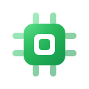
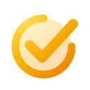
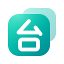

# Antigravity 2.0 Plugins

Domain-scoped Antigravity 2.0 plugins layered over `../skills/` via each plugin's `skills.json` (core domain plugins align 1:1 with `skills/<category>/`, while upstream `skills/in-progress/*` and `skills/misc/*` are combined into `in-progress`), avoiding skill file duplication and preserving upstream sync paths and locks.

## Plugin Inventory

| Logo | Plugin | Display Name | Default State | Mapped Skills | Scoped Rules |
| :---: | --- | --- | --- | --- | --- |
| [](./software/assets/logo.svg) | [`software`](./software/plugin.json) | 軟體開發（Software） | Enabled | `skills/software/*` (19) | [`rules/AGENTS.md`](./software/rules/AGENTS.md) |
| [](./hardware/assets/logo.svg) | [`hardware`](./hardware/plugin.json) | 硬體開發（Hardware） | Enabled | `skills/hardware/*` (3) | [`rules/AGENTS.md`](./hardware/rules/AGENTS.md) |
| [](./productivity/assets/logo.svg) | [`productivity`](./productivity/plugin.json) | 通用協作與生產力（Productivity） | Enabled | `skills/productivity/*` (10) | — |
| [](./language/assets/logo.svg) | [`language`](./language/plugin.json) | 台灣用語規範（Language） | Enabled | `skills/language/*` (1) | — |
| [](./ui-design/assets/logo.svg) | [`ui-design`](./ui-design/plugin.json) | Web 與介面設計（UI Design） | Disabled | `skills/ui-design/*` (20) | [`rules/AGENTS.md`](./ui-design/rules/AGENTS.md) |
| [](./security/assets/logo.svg) | [`security`](./security/plugin.json) | 資安稽核（Security） | Disabled | `skills/security/*` (1) | [`rules/AGENTS.md`](./security/rules/AGENTS.md) |
| [](./in-progress/assets/logo.svg) | [`in-progress`](./in-progress/plugin.json) | 上游開發中與雜項（In Progress & Misc） | Disabled | `skills/in-progress/*` + `skills/misc/*` (10) | — |

## Plugin Icons

Each plugin declares `"logo": "assets/logo.svg"` in `plugin.json` using a path relative to the plugin directory (URLs and absolute paths are ignored by Antigravity):

- **Format**: Square `128x128` (`viewBox="0 0 64 64"`) transparent-background SVG with safe margins inside `[8, 56]`.
- **Style**: Distinct single-color-family analogous gradient (`linearGradient` + upper-left `radialGradient` gloss) masked onto rounded geometric shapes, using `userSpaceOnUse` coordinates, unique per-plugin `<defs>` IDs, and fixed hex colors (no `currentColor`) for light and dark theme legibility.
- **Cache Refresh**: After editing local `assets/logo.svg` files, reload the window or restart the Antigravity App to refresh cached icons in **Customizations > Installed**.

## Manifest, Mapping & Rules Contracts

Repository CI (`.github/upstream-sync/validate.mjs`) enforces the following contracts across `plugins/<name>/`:

- **`plugin.json`**: Allowed top-level fields are `name`, `displayName`, `description`, `version`, `author`, `homepage`, `repository`, `logo`, `suggestedPrompts`, and `disabled`. `name` (lowercase kebab-case matching the directory), `version`, and `description` are required; `"disabled": true` ships a plugin disabled by default (`ui-design`, `security`, `in-progress`).
- **`skills.json`**: Requires a non-empty `entries` array with in-repository `path` values and optional regex `include_only` / `exclude` patterns. Together, all plugins must map 100% of runtime skills in `skills/` with no overlap.
- **`rules/AGENTS.md`** (optional, present in `software`, `hardware`, `ui-design`, `security`): Must be a regular file, `<= 24,000` bytes, and contain **no YAML frontmatter** (unlike root `rules/skills.md`).

## Global Registration

For one-prompt Antigravity installation or the automated mount scripts (`mount.ps1` / `mount.sh`), see [Quick Start](../README.md#快速開始).

To configure manually, register this directory globally in `~/.gemini/config/plugins.json` using an **absolute path** (Antigravity's plugin loader does not expand `~/` inside `plugins.json`):

```json
{
  "entries": [
    {
      "path": "C:/Users/<user>/.agents/plugins"
    }
  ]
}
```

On Linux, WSL, or Raspberry Pi, use `/home/<user>/.agents/plugins` (on macOS, `/Users/<user>/.agents/plugins`).

Toggle plugins on demand from the Antigravity **Customizations > Installed** UI or via CLI:

```bash
agy plugin list
agy plugin enable ui-design
agy plugin disable hardware
```
